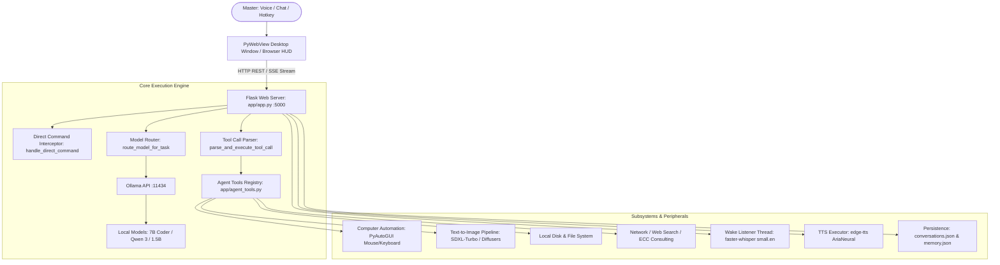

# ✦ Ciel Desktop Assistant — Initial Project Analysis & Architecture Audit

> **Document Type**: Architecture & Security Audit Report (Phase 1)  
> **Audited Modules**: `app/app.py`, `app/agent_tools.py`, `app/security.py`, `app/launch_desktop.py`, `chats/`  
> **Date**: September 27, 2026  
> **Target OS**: Windows 11 Workstation  

---

## 1. Current Architecture Overview

The Ciel backend is a hybrid desktop assistant combining:
1. **Host Layer**: Native Windows PyWebView container (`launch_desktop.py`) with native icon and taskbar app model binding.
2. **Server Core**: Monolithic Flask server (`app.py`, 1,345 lines) with SSE event streams, serving a customized cyberpunk HUD interface (`templates/index.html`).
3. **Execution Layer**: Python tool registry (`agent_tools.py`, 2,439 lines) holding 28 autonomous tools, multi-step computer automation routines, and instant regex interceptors.
4. **Local AI Engines**: Ollama (for language models) and Hugging Face Diffusers (for image generation), running entirely offline with zero cloud API dependencies.

---

## 2. All Flask API Endpoints (36 Endpoints)

| Endpoint | Method | Source Location | Function & Purpose |
| :--- | :--- | :--- | :--- |
| `/` | `GET` | [`app.py:568`](file:///C:/Users/Lenovo/Ciel/app/app.py#L568) | Serves the main HUD dashboard template. |
| `/static/images/<filename>` | `GET` | [`app.py:572`](file:///C:/Users/Lenovo/Ciel/app/app.py#L572) | Serves generated PNG artwork files. |
| `/api/version` | `GET` | [`app.py:576`](file:///C:/Users/Lenovo/Ciel/app/app.py#L576) | Returns active application version (`v5.2.0`). |
| `/api/health` | `GET` | [`app.py:580`](file:///C:/Users/Lenovo/Ciel/app/app.py#L580) | System health telemetry, RAM status, Ollama connectivity. |
| `/api/models` | `GET` | [`app.py:599`](file:///C:/Users/Lenovo/Ciel/app/app.py#L599) | Lists installed and available Ollama models. |
| `/api/models/purge` | `POST` | [`app.py:610`](file:///C:/Users/Lenovo/Ciel/app/app.py#L610) | Unloads all loaded models from VRAM/RAM (`keep_alive: 0`). |
| `/api/system/shutdown` | `POST` | [`app.py:624`](file:///C:/Users/Lenovo/Ciel/app/app.py#L624) | Unloads models, stops wake loop, and terminates process. |
| `/api/sysinfo` | `GET` | [`app.py:651`](file:///C:/Users/Lenovo/Ciel/app/app.py#L651) | Returns CPU, RAM, Disk, Battery, and Ollama VRAM usage. |
| `/api/clipboard/analyze` | `POST, GET` | [`app.py:707`](file:///C:/Users/Lenovo/Ciel/app/app.py#L707) | Reads clipboard and returns an analytical diagnostics report. |
| `/api/tts` | `POST` | [`app.py:715`](file:///C:/Users/Lenovo/Ciel/app/app.py#L715) | Synthesizes spoken audio using Edge TTS. |
| `/api/tts/audio/<filename>` | `GET` | [`app.py:734`](file:///C:/Users/Lenovo/Ciel/app/app.py#L734) | Streams generated `.mp3` speech audio file. |
| `/api/voice/wake_toggle` | `POST` | [`app.py:739`](file:///C:/Users/Lenovo/Ciel/app/app.py#L739) | Starts or stops the background wake listener thread. |
| `/api/voice/wake_poll` | `GET` | [`app.py:760`](file:///C:/Users/Lenovo/Ciel/app/app.py#L760) | Frontend polling endpoint to retrieve detected voice directives. |
| `/api/voice/pause_wake` | `POST` | [`app.py:768`](file:///C:/Users/Lenovo/Ciel/app/app.py#L768) | Pauses wake word detection during active speaking/listening. |
| `/api/voice/resume_wake` | `POST` | [`app.py:777`](file:///C:/Users/Lenovo/Ciel/app/app.py#L777) | Resumes wake detection. |
| `/api/voice/listen_once` | `POST` | [`app.py:789`](file:///C:/Users/Lenovo/Ciel/app/app.py#L789) | Captures a single phrase directly without wake word. |
| `/api/chat` | `POST` | [`app.py:902`](file:///C:/Users/Lenovo/Ciel/app/app.py#L902) | Primary chat SSE stream: model routing, LLM streaming, tool execution. |
| `/api/permission/pending` | `GET` | [`app.py:1050`](file:///C:/Users/Lenovo/Ciel/app/app.py#L1050) | Polled by frontend for dangerous tool confirmation modals. |
| `/api/permission/respond` | `POST` | [`app.py:1058`](file:///C:/Users/Lenovo/Ciel/app/app.py#L1058) | Submits user's Allow / Deny decision for a pending tool. |
| `/api/permission/reset_scopes` | `POST` | [`app.py:1083`](file:///C:/Users/Lenovo/Ciel/app/app.py#L1083) | Resets one-session broad permission grants. |
| `/api/chats` | `GET` | [`app.py:1089`](file:///C:/Users/Lenovo/Ciel/app/app.py#L1089) | Returns all conversation sessions metadata. |
| `/api/chats/<chat_id>` | `GET` | [`app.py:1099`](file:///C:/Users/Lenovo/Ciel/app/app.py#L1099) | Retrieves full message history for a conversation. |
| `/api/chats/<chat_id>` | `POST` | [`app.py:1106`](file:///C:/Users/Lenovo/Ciel/app/app.py#L1106) | Saves/updates conversation message trajectory. |
| `/api/chats/<chat_id>` | `DELETE` | [`app.py:1120`](file:///C:/Users/Lenovo/Ciel/app/app.py#L1120) | Deletes a conversation session. |
| `/api/image-models` | `GET` | [`app.py:1129`](file:///C:/Users/Lenovo/Ciel/app/app.py#L1129) | Returns available text-to-image models. |
| `/api/generate-image` | `POST` | [`app.py:1143`](file:///C:/Users/Lenovo/Ciel/app/app.py#L1143) | Synthesizes AI artwork using local Diffusers pipeline. |
| `/api/ide/tree` | `GET` | [`app.py:1174`](file:///C:/Users/Lenovo/Ciel/app/app.py#L1174) | Returns directory file tree for embedded IDE. |
| `/api/ide/read` | `POST` | [`app.py:1195`](file:///C:/Users/Lenovo/Ciel/app/app.py#L1195) | Reads file contents for embedded IDE code editor. |
| `/api/ide/save` | `POST` | [`app.py:1212`](file:///C:/Users/Lenovo/Ciel/app/app.py#L1212) | Writes file changes back to disk. |
| `/api/ide/create` | `POST` | [`app.py:1230`](file:///C:/Users/Lenovo/Ciel/app/app.py#L1230) | Creates new files or directories in IDE workspace. |
| `/api/ide/run` | `POST` | [`app.py:1255`](file:///C:/Users/Lenovo/Ciel/app/app.py#L1255) | Executes the currently active code file. |
| `/api/memory` | `GET` | [`app.py:1330`](file:///C:/Users/Lenovo/Ciel/app/app.py#L1330) | Retrieves all stored long-term memory facts. |
| `/api/memory` | `POST` | [`app.py:1334`](file:///C:/Users/Lenovo/Ciel/app/app.py#L1334) | Manually adds a long-term memory fact. |
| `/api/memory/<mem_id>` | `DELETE` | [`app.py:1343`](file:///C:/Users/Lenovo/Ciel/app/app.py#L1343) | Deletes a memory fact by ID. |
| `/api/memory/clear` | `POST` | [`app.py:1353`](file:///C:/Users/Lenovo/Ciel/app/app.py#L1353) | Clears all long-term memory facts. |
| `/api/ollama/start` | `POST` | [`app.py:1358`](file:///C:/Users/Lenovo/Ciel/app/app.py#L1358) | Spawns `ollama serve` if Ollama is not running. |

---

## 3. All Registered Tools (28 Tools)

All tools are declared in [`agent_tools.py:1915-1950`](file:///C:/Users/Lenovo/Ciel/app/agent_tools.py#L1915):

| Tool Name | Handler Function | Domain | Parameters |
| :--- | :--- | :--- | :--- |
| `execute_computer_task` | `tool_execute_computer_task` | Computer-Use | `target`, `task_description`, `steps` |
| `computer_mouse` | `tool_computer_mouse` | UI Automation | `action`, `x`, `y`, `button`, `clicks`, `scroll_amount` |
| `computer_keyboard` | `tool_computer_keyboard` | UI Automation | `action`, `text`, `keys`, `press_enter`, `delay` |
| `computer_see` | `tool_computer_see` | Vision / Screen | `save_path` |
| `focus_window` | `tool_focus_window` | Window Mgmt | `window_title` |
| `open_application` | `tool_open_application` | OS Launch | `target` |
| `play_youtube` | `tool_play_youtube` | Entertainment | `query`, `browser` |
| `generate_presentation` | `tool_generate_presentation` | Productivity | `topic`, `num_slides` |
| `system_control` | `tool_system_control` | Hardware | `action`, `value` |
| `deep_research` | `tool_deep_research` | Research | `query`, `max_sources` |
| `inspect_screen_context` | `tool_inspect_screen_context` | Perception | *(none)* |
| `launch_routine` | `tool_launch_routine` | Routines | `mode` |
| `ecc_consult` | `tool_ecc_consult` | Engineering | `query`, `domain` |
| `ecc_agent_run` | `tool_ecc_agent_run` | Engineering | `agent_name`, `target` |
| `read_file` | `tool_read_file` | Filesystem | `path` |
| `write_file` | `tool_write_file` | Filesystem | `path`, `content` |
| `create_file` | `tool_create_file` | Filesystem | `path`, `content` |
| `list_directory` | `tool_list_directory` | Filesystem | `path` |
| `create_folder` | `tool_create_folder` | Filesystem | `path` |
| `delete_file` | `tool_delete_file` | Filesystem | `path` |
| `run_python` | `tool_run_python` | Code Execution | `script_path` |
| `run_command` | `tool_run_command` | Shell Execution| `command` |
| `search_files` | `tool_search_files` | Filesystem | `directory`, `pattern` |
| `web_search` | `tool_web_search` | Web Search | `query` |
| `fetch_webpage` | `tool_fetch_webpage` | Web Fetch | `url` |
| `get_clipboard` | `tool_get_clipboard` | Clipboard | *(none)* |
| `set_clipboard` | `tool_set_clipboard` | Clipboard | `text` |
| `analyze_clipboard` | `tool_analyze_clipboard` | Diagnostics | `instruction` |
| `take_screenshot` | `tool_take_screenshot` | Perception | `save_path` |
| `generate_image` | `tool_generate_image` | Art Synthesis | `prompt`, `image_model`, `width`, `height`, `steps` |
| `draw_in_paint` | `tool_draw_in_paint` | Drawing Canvas | `subject` |

---

## 4. Dangerous Operations

1. **Arbitrary Command Execution (`run_command`)** — [`agent_tools.py:150`](file:///C:/Users/Lenovo/Ciel/app/agent_tools.py#L150)  
   Executes arbitrary PowerShell commands with full user privileges. While now guarded by `request_permission`, a compromised model output could request destructive commands (e.g. `rm -rf`, disk wipes).
2. **Permanent File & Directory Deletion (`delete_file`)** — [`agent_tools.py:127`](file:///C:/Users/Lenovo/Ciel/app/agent_tools.py#L127)  
   Calls `shutil.rmtree` or `os.remove` directly without placing files into the Windows Recycle Bin (`winshell.send_to_trash` or `SHFileOperation`).
3. **Arbitrary Filesystem Writes without Workspace Boundary** — [`agent_tools.py:100-116`](file:///C:/Users/Lenovo/Ciel/app/agent_tools.py#L100)  
   `tool_write_file` and `tool_create_file` do not call `workspace_path()`. An LLM can theoretically write or overwrite files anywhere in `%USERPROFILE%`.
4. **PyAutoGUI FailSafe Disabled** — [`agent_tools.py:397, 856`](file:///C:/Users/Lenovo/Ciel/app/agent_tools.py#L397)  
   `pyautogui.FAILSAFE = False` removes the emergency abort trigger (moving cursor to corner). If mouse automation gets caught in a loop, user must use Task Manager to kill the process.
5. **Brutal Process Termination (`api_shutdown`)** — [`app.py:630`](file:///C:/Users/Lenovo/Ciel/app/app.py#L630)  
   Uses `os._exit(0)` inside a daemon thread. This bypasses Python cleanup, flushing of open write buffers, and atexit handlers.

---

## 5. Blocking Operations (Latency Bottlenecks)

1. **Text-to-Image Generation (`generate-image`)** — [`app.py:1143`](file:///C:/Users/Lenovo/Ciel/app/app.py#L1143)  
   Running Diffusers on CPU takes 60–120 seconds. Because it runs synchronously inside the Flask request thread, that worker thread is completely tied up.
2. **Synchronous LLM Streaming (`_stream_ollama`)** — [`app.py:954`](file:///C:/Users/Lenovo/Ciel/app/app.py#L954)  
   Holds the HTTP request socket open for up to 300 seconds. If network or model generation stalls, the client connection hangs.
3. **Synchronous Edge TTS Synthesis** — [`app.py:283`](file:///C:/Users/Lenovo/Ciel/app/app.py#L283)  
   Spawns `asyncio.run(_gen())` inside a ThreadPoolExecutor limited to `max_workers=2`. Rapid speech requests block the queue.
4. **Physical Canvas Drawing (`tool_draw_in_paint`)** — [`agent_tools.py:391`](file:///C:/Users/Lenovo/Ciel/app/agent_tools.py#L391)  
   Executes hundreds of `pyautogui.moveTo` calls with `time.sleep` intervals over 5–10 seconds on the active request thread.
5. **PowerPoint Deck Generation** — [`agent_tools.py:750`](file:///C:/Users/Lenovo/Ciel/app/agent_tools.py#L750)  
   Performs synchronous LLM queries to outline 5 slides, then constructs the PPTX file.

---

## 6. Global State & Concurrency Risks

1. **Unbounded Model Cache (`_loaded_pipes`)** — [`app.py:223`](file:///C:/Users/Lenovo/Ciel/app/app.py#L223)  
   Loaded PyTorch diffusion models are stored in a global dictionary and never unloaded. Generating images with multiple models will quickly exhaust laptop RAM.
2. **Microphone Concurrency Conflict** — [`app.py:395, 789`](file:///C:/Users/Lenovo/Ciel/app/app.py#L395)  
   The background `_native_wake_loop` holds a continuous stream on the microphone. If the user invokes `/api/voice/listen_once` while wake is active, both threads fight for the hardware device.
3. **Global Conversation Window (`_conversation_window_until`)** — [`app.py:356`](file:///C:/Users/Lenovo/Ciel/app/app.py#L356)  
   A raw floating-point timestamp accessed across threads without lock synchronization.
4. **Unbounded Wake Event Queue (`_wake_queue`)** — [`app.py:366`](file:///C:/Users/Lenovo/Ciel/app/app.py#L366)  
   If the browser UI is closed or disconnected, detected wake events accumulate in `_wake_queue` indefinitely.

---

## 7. Persistence Risks

1. **Non-Atomic Chat Persistence (`save_all_chats`)** — [`app.py:186`](file:///C:/Users/Lenovo/Ciel/app/app.py#L186)  
   `save_all_chats` opens `conversations.json` directly with `open(..., "w")`. A crash, forced shutdown, or power cut during write results in permanent file truncation to 0 bytes.
2. **Monolithic Storage Bottleneck** — [`chats/conversations.json`](file:///C:/Users/Lenovo/Ciel/chats/conversations.json)  
   The entire conversation history across all sessions is stored in a single JSON file. As history grows to hundreds of messages, parsing and saving the entire blob on every single turn creates noticeable disk I/O lag.
3. **No Database Migration / Versioning**: Neither `conversations.json` nor `memory.json` contains schema versions or validation schemas.

---

## 8. Ollama Integration Risks

1. **Hardcoded Host (`http://127.0.0.1:11434`)** — [`app.py:54`](file:///C:/Users/Lenovo/Ciel/app/app.py#L54)  
   Cannot be overridden via environment variables or configuration files.
2. **Unvalidated Model Routing** — [`app.py:912`](file:///C:/Users/Lenovo/Ciel/app/app.py#L912)  
   `route_model_for_task` picks models (`qwen2.5-coder:7b`, `qwen3:latest`) based on prompt keywords, but never queries `ollama list` to verify if the model is actually installed before calling `/api/chat`.
3. **Crash Recovery Lag** — [`app.py:972`](file:///C:/Users/Lenovo/Ciel/app/app.py#L972)  
   If Ollama is down, `_stream_ollama` spawns `ollama.exe serve` and sleeps for a rigid 2.5 seconds. Large models can take 5–10 seconds to warm up, causing the retry request to fail prematurely.

---

## 9. Voice Pipeline Risks

1. **Hardware Sample Rate Lock** — [`app.py:399`](file:///C:/Users/Lenovo/Ciel/app/app.py#L399)  
   PyAudio is configured strictly with `RATE = 16000`. Many Windows USB/Bluetooth headsets only support 44,100 Hz or 48,000 Hz input, throwing an `[Errno -9997] Invalid sample rate` crash.
2. **PyAudio Resource Leaks on Loop Crashes** — [`app.py:413`](file:///C:/Users/Lenovo/Ciel/app/app.py#L413)  
   If an exception occurs within `stream.read()`, the `stream` and `pyaudio` instance are recreated in the loop; repeated failures can exhaust Windows audio handles.
3. **Fixed RMS Threshold (`0.008`)** — [`app.py:401`](file:///C:/Users/Lenovo/Ciel/app/app.py#L401)  
   A static threshold causes voice detection to fail in noisy environments (fans, mechanical keyboards) or fail to register soft speech.

---

## 10. Top 15 Prioritized Improvements

| Priority | Issue / Target | File & Location | Problem & Consequence | Recommended Architectural Fix |
| :---: | :--- | :--- | :--- | :--- |
| **1. CRITICAL** | Non-Atomic Chat Writes | [`app.py:186`](file:///C:/Users/Lenovo/Ciel/app/app.py#L186) | Crash during `open("w")` wipes `conversations.json` to 0 bytes. | Implement atomic tempfile write (`.tmp` &rarr; `os.replace`) matching `save_memory`. |
| **2. CRITICAL** | Filesystem Tools Path Escape | [`agent_tools.py:100-127`](file:///C:/Users/Lenovo/Ciel/app/agent_tools.py#L100) | `read_file`, `write_file`, `delete_file` bypass `workspace_path()`. | Enforce `workspace_path()` check on all agent filesystem tools. |
| **3. CRITICAL** | Recycle Bin Protection | [`agent_tools.py:127`](file:///C:/Users/Lenovo/Ciel/app/agent_tools.py#L127) | `delete_file` uses unrecoverable `os.remove`/`rmtree`. | Use Windows Shell trash (`send2trash` or `SHFileOperation`) for safe recovery. |
| **4. HIGH** | Background Task Manager | [`app.py:1143`](file:///C:/Users/Lenovo/Ciel/app/app.py#L1143) | Image generation & computer tasks block Flask workers for minutes. | Build async task queue (`TaskRunner` / ThreadPool) with `/api/tasks` status polling. |
| **5. HIGH** | Dynamic Model Router Fallback | [`app.py:912`](file:///C:/Users/Lenovo/Ciel/app/app.py#L912) | Router fails if designated model is missing from Ollama. | Query installed tags dynamically; fall back gracefully to any available model. |
| **6. HIGH** | Audio Mutex for Mic Device | [`app.py:395, 789`](file:///C:/Users/Lenovo/Ciel/app/app.py#L395) | Wake loop and `listen_once` crash when accessing mic concurrently. | Introduce `threading.Lock` protecting PyAudio stream acquisition. |
| **7. HIGH** | Audio Sample Rate Resampler | [`app.py:399`](file:///C:/Users/Lenovo/Ciel/app/app.py#L399) | Rigid 16kHz rate crashes on 44.1kHz/48kHz USB microphones. | Auto-detect device default rate and downsample to 16kHz via numpy. |
| **8. HIGH** | Diffusers Memory Purge | [`app.py:223`](file:///C:/Users/Lenovo/Ciel/app/app.py#L223) | Image generation models remain in RAM indefinitely (3–5 GB leak). | Add an auto-unload timer or explicit model release after 5 minutes idle. |
| **9. MEDIUM** | Modular Architecture Split | [`app.py`](file:///C:/Users/Lenovo/Ciel/app/app.py) & [`agent_tools.py`](file:///C:/Users/Lenovo/Ciel/app/agent_tools.py) | Monoliths (>3,800 lines total) are brittle and difficult to maintain. | Refactor into clean domain modules (`api/`, `core/`, `tools/`, `voice/`). |
| **10. MEDIUM** | Granular Chat Storage | [`app.py:180`](file:///C:/Users/Lenovo/Ciel/app/app.py#L180) | Single 100KB+ JSON file parsed and serialized on every chat event. | Store individual chats as separate JSON files (`chats/<id>.json`). |
| **11. MEDIUM** | Typed Configuration System | [`app.py:53-68`](file:///C:/Users/Lenovo/Ciel/app/app.py#L53) | Hardcoded ports, URLs, timeouts, and directories. | Create `config.py` with pydantic/dataclass and `.env` support. |
| **12. MEDIUM** | Re-enable PyAutoGUI FailSafe | [`agent_tools.py:397`](file:///C:/Users/Lenovo/Ciel/app/agent_tools.py#L397) | User cannot break out of runaway mouse movements. | Enable failsafe with graceful exception catching rather than total disabling. |
| **13. MEDIUM** | Graceful Shutdown Pipeline | [`app.py:630`](file:///C:/Users/Lenovo/Ciel/app/app.py#L630) | `os._exit(0)` bypasses cleanup and lock disposal. | Signal event loop, terminate audio cleanly, flush buffers, then exit. |
| **14. LOW** | Standardized API Envelopes | [`app.py`](file:///C:/Users/Lenovo/Ciel/app/app.py) | Endpoints return inconsistent payloads (`{status: ...}`, `{success: ...}`). | Standardize to `{success, data, error, request_id, timestamp}`. |
| **15. LOW** | Rotating Log Handler | [`app.py:51`](file:///C:/Users/Lenovo/Ciel/app/app.py#L51) | Console-only logging loses historical debugging context. | Implement `RotatingFileHandler` with 10MB caps and structured log tags. |
