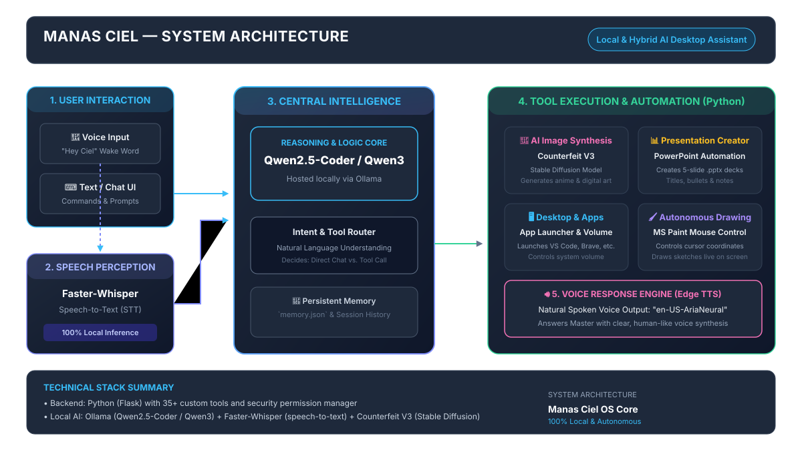

<div align="center">

# ✦ MANAS CIEL

### *Autonomous AI Desktop Assistant & Intelligence Core*

[](https://www.python.org/)
[](https://flask.palletsprojects.com/)
[](https://ollama.com/)
[](https://github.com/SYSTRAN/faster-whisper)
[](LICENSE)
[](https://microsoft.com/windows)

<p align="center">
  <b>A private, offline-capable AI desktop companion inspired by Wisdom King Raphael / Manas Ciel.</b><br/>
  Featuring hands-free voice control, autonomous multi-step computer automation, real-time mouse painting, and intelligent local model routing.
</p>

</div>

---

## 🏛️ System Architecture

<div align="center">
  
</div>

---

## ✨ Key Features & Capabilities

### 🧠 1. Multi-Engine Intelligence Router
Ciel dynamically delegates tasks to specialized local models running on your hardware:
* **Primary Intelligence Core** (`qwen2.5-coder:7b`): Handles reasoning, coding, document creation, and tool calling.
* **Deep Reasoning Engine** (`qwen3:latest`): Engages for complex mathematical logic proofs and multi-step analyses.
* **Ultra-Fast Speed Engine** (`qwen2.5-coder:1.5b`): Executes instant status inquiries and short commands in under a second.
* **Text-to-Image Synthesis** (`sdxl-turbo` / Stable Diffusion): Synthesizes digital artwork directly onto canvas and desktop.

### 🎙️ 2. Hands-Free Voice Perception & Speech
* **Voice Ear**: Offline wake-word detection (*"Ciel"*, *"Hey Ciel"*) powered by `faster-whisper` (`small.en`, int8 quantization).
* **Vocal Core**: Smooth, natural speech responses utilizing Microsoft Edge Neural TTS (`en-US-AriaNeural`).

### 🖱️ 3. Autonomous Computer Control & Automation
* **Live App Automation**: Controls apps and browsers (Canva, Google Docs, Notion, Sheets, Calculator).
* **Autonomous MS Paint Sketching**: Launches MS Paint and autonomously guides the cursor to draw cats, stars, hearts, and houses in real time.
* **System Telemetry & Control**: Real-time VRAM monitoring, memory purging (`/api/models/purge`), clipboard analysis, and hotkey listeners.

---

## 📁 Repository Structure

```text
Ciel/
├── app/
│   ├── app.py                 # Core Flask application, API router & SSE server
│   ├── agent_tools.py         # 35+ autonomous tools & execution registry
│   ├── launch_desktop.py      # PyWebView native desktop window container
│   ├── launcher.cs            # Native C# launcher source
│   ├── model_router.py        # Dynamic LLM routing engine
│   ├── primitive_engine.py    # Autonomous canvas and drawing routines
│   ├── security.py            # Tool safety guardrails and permissions
│   ├── task_manager.py        # Asynchronous background task scheduler
│   ├── requirements.txt       # Python dependencies
│   ├── static/                # Cyberpunk HUD styles, icons & animations
│   └── templates/             # HUD interface template (index.html)
├── docs/
│   └── ciel_architecture.svg  # Complete system architecture diagram
├── plans/
│   └── ciel-improvement-roadmap.md   # Architectural roadmap and hardening plan
├── tests/                     # Automated test harness & security validations
├── CIEL_CAPABILITIES.md       # Detailed operations & commands reference
├── CONFIG_GUIDE.md            # Hardware & model configuration guide
├── INITIAL_PROJECT_ANALYSIS.md# Technical audit and API reference
├── INSTALL_DEPENDENCIES.bat   # One-click dependency installer
├── RUN_CIEL.bat               # One-click desktop launcher
├── RUN_CIEL_COMPANION.bat     # Compact taskbar companion launcher
├── LICENSE                    # MIT Open Source License
└── README.md                  # Project documentation
```

---

## 🚀 Getting Started

### Prerequisites
1. **Windows 10 / 11** (64-bit).
2. **Python 3.10+** (ensure `Add Python to PATH` is checked during install).
3. **[Ollama](https://ollama.com/)** installed and running locally.
   ```bash
   ollama pull qwen2.5-coder:7b
   ```

### 1. Installation
Clone the repository:
```bash
git clone https://github.com/N1412N/Ciel.git
cd Ciel
```

Install required Python dependencies:
* Run **`INSTALL_DEPENDENCIES.bat`**  
  *or manually:*
```bash
pip install -r app/requirements.txt
```

### 2. Launching Ciel
Simply double-click **`RUN_CIEL.bat`** (or `Ciel.exe`).

The desktop HUD interface will open maximized with hands-free voice detection active!

---

## 🧪 Running Tests

The test suite covers backend security, model routing, safety guardrails, and APIs:
```bash
pytest tests/
```

---

## 🙏 Acknowledgements & Open-Source Credits

Manas Ciel is built upon and inspired by incredible open-source projects, models, and libraries. Sincere gratitude and full credit to the following creators and repositories:

### 🧠 Local AI & Intelligence Engines
* **[Ollama](https://github.com/ollama/ollama)** (`ollama/ollama`) — High-performance local LLM execution engine and inference server.
* **[Qwen 2.5](https://github.com/QwenLM/Qwen2.5)** & **[Qwen](https://github.com/QwenLM/Qwen)** (`QwenLM/Qwen2.5`) — Primary intelligence, code reasoning, and logic models (`qwen2.5-coder:7b`, `qwen2.5-coder:1.5b`, `qwen3`) by Alibaba Cloud.
* **[Diffusers](https://github.com/huggingface/diffusers)** (`huggingface/diffusers`) — Pretrained diffusion pipelines for text-to-image artwork synthesis (SDXL-Turbo, Stable Diffusion) by Hugging Face & Stability AI.
* **[Real-ESRGAN](https://github.com/xinntao/Real-ESRGAN)** (`xinntao/Real-ESRGAN`) — Deep learning image super-resolution and anime restoration algorithms by Xintao Wang.

### 🎙️ Voice Perception & Audio Synthesis
* **[Faster-Whisper](https://github.com/SYSTRAN/faster-whisper)** (`SYSTRAN/faster-whisper`) — Fast, quantized OpenAI Whisper implementation using CTranslate2 by SYSTRAN.
* **[CTranslate2](https://github.com/OpenNMT/CTranslate2)** (`OpenNMT/CTranslate2`) — Ultra-fast inference engine for Transformer models by OpenNMT.
* **[OpenAI Whisper](https://github.com/openai/whisper)** (`openai/whisper`) — Foundational automatic speech recognition (ASR) architecture by OpenAI.
* **[Edge-TTS](https://github.com/rany2/edge-tts)** (`rany2/edge-tts`) — Python interface for Microsoft Edge's neural text-to-speech voice synthesis by rany2.
* **[SpeechRecognition](https://github.com/Uberi/speech_recognition)** (`Uberi/speech_recognition`) — Library for microphone audio capture and processing by Anthony Zhang (Uberi).

### 🖱️ Desktop GUI & Computer Automation
* **[PyWebView](https://github.com/r0x0d/pywebview)** (`r0x0d/pywebview`) — Lightweight, native cross-platform desktop GUI window container by Roman Sirokov.
* **[Flask](https://github.com/pallets/flask)** (`pallets/flask`) — Python WSGI micro web framework and SSE streaming core by Pallets.
* **[PyAutoGUI](https://github.com/asweigart/pyautogui)** (`asweigart/pyautogui`) — Cross-platform GUI automation for programmatic mouse/keyboard control by Al Sweigart.
* **[mss](https://github.com/BoboTiG/python-mss)** (`BoboTiG/python-mss`) — Ultra-fast cross-platform screen capture module in pure Python by Mickaël Schoentgen.
* **[Winotify](https://github.com/versa-sy/winotify)** (`versa-sy/winotify`) — Native Windows 10/11 toast notification engine by Versa-sy.
* **[Send2Trash](https://github.com/arsenetar/send2trash)** (`arsenetar/send2trash`) — Safe, native Windows Recycle Bin deletion module by Arsen Tarverdyan.
* **[Keyboard](https://github.com/boppreh/keyboard)** (`boppreh/keyboard`) — Global Windows keyboard hooks and hotkey listeners by Boppreh.

### 🎨 Creative Tools & Core Utilities
* **[Primitive](https://github.com/fogleman/primitive)** (`fogleman/primitive`) — Geometric primitive art reproduction algorithm utilizing hill-climbing optimization by Michael Fogleman.
* **[OpenJarvis](https://github.com/open-jarvis/OpenJarvis)** (`open-jarvis/OpenJarvis`) — Stanford OpenJarvis cognitive extension abstractions and agent tools.
* **[DuckDuckGo Search](https://github.com/deedy5/duckduckgo_search)** (`deedy5/duckduckgo_search`) — Live web search integration without API keys by deedy5.
* **[BeautifulSoup4](https://www.crummy.com/software/BeautifulSoup/)** — HTML/XML parsing for web inspection tools by Leonard Richardson.
* **[OpenCV](https://github.com/opencv/opencv)** & **[Pillow](https://github.com/python-pillow/Pillow)** — Computer vision, color analysis, and image manipulation.

---

## 🛡️ License

This project is licensed under the [MIT License](LICENSE) — Copyright (c) 2026 **N1412N**.